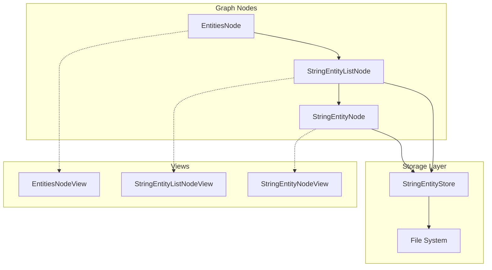

# String Entities

String entities provide a simple persistent storage system for text data, integrated with the graph UI for viewing and editing.

## Architecture Overview



## Storage Layer

### StringEntityStore

**File:** [string.fnl](https://github.com/semanticdreams/spacecore/blob/main/assets/lua/entities/string.fnl)

The `StringEntityStore` manages persistence of string entities to disk using markdown files with YAML frontmatter.

#### Storage Format

Each entity is stored as a `.md` file in `<user-data-dir>/entities/string/`:

```markdown
---
id: <uuid>
created-at: <unix-timestamp>
updated-at: <unix-timestamp>
---

<entity value text>
```

#### API

| Method | Description |
|--------|-------------|
| `create-entity(opts)` | Creates a new entity with optional `value`, returns entity |
| `get-entity(id)` | Retrieves entity by ID |
| `update-entity(id, updates)` | Updates entity fields, auto-updates `updated-at` |
| `retire-entity!(id)` | INTERNAL physical removal from disk/cache; not a logical-delete command |
| `list-entities()` | Returns all entities, sorted by `updated-at` (newest first) |

Application deletion uses the node's existing `delete-entity` or canonical
`Lifecycle:delete!("string-entity:<id>")`, which removes live incoming references
across unopened owners before retiring the source. The store has no old
`delete-entity` alias. Snapshot/serialize/decode/prepared persist/reconcile methods
are internal lifecycle persistence tools, not alternative user deletion APIs.
Required IO failures are explicit; caches/signals publish after successful writes.
See [Reference lifecycle](../features/reference-lifecycle.md).

#### Signals

The store emits signals for entity lifecycle events:

- `string-entity-created` — Emitted when a new entity is created
- `string-entity-updated` — Emitted when an entity is modified
- `string-entity-deleted` — Emitted when an entity is deleted

#### Singleton Access

```fennel
(local StringEntityStore (require :entities/string))
(local store (StringEntityStore.get-default))
```

Main composes this canonical store and the canonical code default with one
normalized root and shared IdentityStore, then recovers/migrates lifecycle before
exposing worlds. Custom injection must preserve exact provider identity/root;
an equal-root substitute is not the same cache/signal owner.

---

## Graph Nodes

### EntitiesNode

**File:** [entities.fnl](https://github.com/semanticdreams/spacecore/blob/main/assets/lua/graph/nodes/entities.fnl)

Root node for browsing entity types from an injected immutable catalog. The
built-in catalog exposes string, link, list, dict, and code. See
[Entity-type catalog](../features/entity-type-catalog.md) for startup composition
and its separation from graph loader installation.

- **Key:** `"entities"`
- **Label:** `"entities"`
- **Color:** Gray

Requires `:entity-type-catalog`. `collect-types` returns `[type-id, label]` rows in
catalog order; generated actions use that same order. `add-type-node` resolves the
selected descriptor's browser key through its containing GraphMap, adds an
explicit display edge, and returns the browser adapter. The SearchView presents
rows alphabetically. Unknown types, missing context and unresolved browser keys
raise explicit errors rather than silently omitting navigation.

### StringEntityListNode

**File:** [string-entity-list.fnl](https://github.com/semanticdreams/spacecore/blob/main/assets/lua/graph/nodes/string-entity-list.fnl)

Displays a paginated list of all string entities.

- **Key:** `"string-entity-list"`
- **Label:** `"string entities"`
- **Color:** Dark green

| Method | Description |
|--------|-------------|
| `collect-items()` | Returns `[[entity, label], ...]` for all entities |
| `emit-items()` | Broadcasts items via `items-changed` signal |
| `create-entity(opts)` | Creates entity and refreshes list |
| `add-entity-node(entity)` | Adds a child `StringEntityNode` to the graph |

Automatically refreshes when the store emits create/update/delete signals.

### StringEntityNode

**File:** [string-entity.fnl](https://github.com/semanticdreams/spacecore/blob/main/assets/lua/graph/nodes/string-entity.fnl)

Represents a single string entity in the graph.

- **Key:** `string-entity:<id>`
- **Label:** Truncated entity value (or ID if empty)
- **Color:** Dark blue

| Method | Description |
|--------|-------------|
| `get-entity()` | Returns current entity data |
| `update-value(new-value)` | Updates the entity's value |
| `delete-entity()` | Logical delete through explicit or checked mounted lifecycle; returns source record |
| `refresh-label()` | Updates label from current value |

Listens to store signals:
- On delete: emits `entity-deleted` and removes self from graph
- On update: refreshes label

Browser submissions mount children into their GraphMap, where destructive actions
acquire its lifecycle with ownership checks. Detached nodes require explicit
`:lifecycle`; conflicting node/graph services fail before effects. Remove from Map
and Clear Map are presentation-only and do not edit domain bytes. String→code
morph preserves stable relationships and presentation, then retires the string
last; it is not a direct call to the store's physical retirement primitive.

---

## Views

### EntitiesNodeView

**File:** [entities.fnl](https://github.com/semanticdreams/spacecore/blob/main/assets/lua/graph/view/views/entities.fnl)

Uses `SearchView` to display available entity types as buttons. Clicking a type calls `node:add-type-node(type-key)`.

### StringEntityListNodeView

**File:** [string-entity-list.fnl](https://github.com/semanticdreams/spacecore/blob/main/assets/lua/graph/view/views/string-entity-list.fnl)

Layout:
1. **Create button** — Calls `node:create-entity({})` then `node:add-entity-node(entity)`
2. **SearchView** — Paginated list of entities; clicking opens the entity node

### StringEntityNodeView

**File:** [string-entity.fnl](https://github.com/semanticdreams/spacecore/blob/main/assets/lua/graph/view/views/string-entity.fnl)

Layout:
1. **Action row** — Copy Value, Copy ID, Delete buttons
2. **Multiline input** — Editable text field bound to entity value

---

## Integration Points

### Start Node

**File:** [start.fnl](https://github.com/semanticdreams/spacecore/blob/main/assets/lua/graph/nodes/start.fnl)

The `EntitiesNode` is included in the start node's target list, making it accessible from the graph root.

### Menu Manager

**File:** [menu-manager.fnl](https://github.com/semanticdreams/spacecore/blob/main/assets/lua/menu-manager.fnl)

A "Create String Entity" action is available in the root menu, which:
1. Creates an entity via `StringEntityStore.get-default()`
2. Adds a `StringEntityNode` to the graph

---

## Testing

### Unit Tests

**File:** [test-string-entities.fnl](https://github.com/semanticdreams/spacecore/blob/main/assets/lua/tests/test-string-entities.fnl)

Covers:
- Store CRUD operations
- Signal emission (created, updated, deleted)
- Multiline value preservation
- Node and view module loading
- Node property initialization

### E2E Snapshot

**File:** [test-string-entity-view.fnl](https://github.com/semanticdreams/spacecore/blob/main/assets/lua/tests/e2e/test-string-entity-view.fnl)

Creates a snapshot of the `StringEntityNodeView` rendered in a dialog with sample multiline content.

---

## File Summary

| File | Purpose |
|------|---------|
| [entities/string.fnl](https://github.com/semanticdreams/spacecore/blob/main/assets/lua/entities/string.fnl) | Storage layer |
| [graph/nodes/entities.fnl](https://github.com/semanticdreams/spacecore/blob/main/assets/lua/graph/nodes/entities.fnl) | Entity type browser node |
| [graph/nodes/string-entity-list.fnl](https://github.com/semanticdreams/spacecore/blob/main/assets/lua/graph/nodes/string-entity-list.fnl) | Entity list node |
| [graph/nodes/string-entity.fnl](https://github.com/semanticdreams/spacecore/blob/main/assets/lua/graph/nodes/string-entity.fnl) | Single entity node |
| [graph/view/views/entities.fnl](https://github.com/semanticdreams/spacecore/blob/main/assets/lua/graph/view/views/entities.fnl) | Type browser view |
| [graph/view/views/string-entity-list.fnl](https://github.com/semanticdreams/spacecore/blob/main/assets/lua/graph/view/views/string-entity-list.fnl) | List view |
| [graph/view/views/string-entity.fnl](https://github.com/semanticdreams/spacecore/blob/main/assets/lua/graph/view/views/string-entity.fnl) | Entity editor view |
| [tests/test-string-entities.fnl](https://github.com/semanticdreams/spacecore/blob/main/assets/lua/tests/test-string-entities.fnl) | Unit tests |
| [tests/e2e/test-string-entity-view.fnl](https://github.com/semanticdreams/spacecore/blob/main/assets/lua/tests/e2e/test-string-entity-view.fnl) | E2E snapshot test |


## See also

- [entity store](./entity-store)
